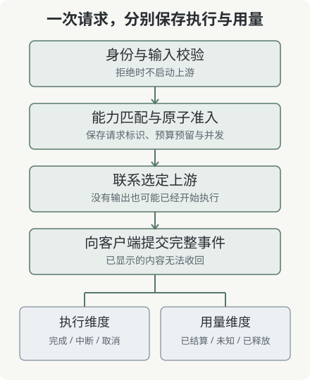

# 第 1 章：从用户请求到一次上游尝试

产品经理说“自动切换到备用模型”，通常是在描述一个业务愿望。实现者需要先补齐几个事实：原模型是否收到请求，是否已经执行，是否有结果发给用户，以及新模型是否允许承担同一个任务。没有这些事实，切换策略会把不确定性隐藏起来。

## 1.1 三种身份分别回答三个问题

业务任务标识回答“用户想完成哪件事”，网关请求标识回答“这次入口调用是什么”，尝试标识回答“哪个上游实际收到了哪次调用”。用户重新点击提交，可能产生新的网关请求；一次明确授权的故障切换，也可能产生第二次尝试。三者不能用同一个递增计数器含混替代。

例如，任务 task-42 的第一次请求 req-a 因网络状态未知而失败。客户端随后发送 req-b。若系统只用 req-a 判断重复，它无法知道两个请求属于同一个业务任务；若系统把 task-42 永远缓存为成功，又会错误吞掉用户修改输入后的新任务。需要去重的范围、保存期限和输入指纹必须一起定义。

本地实验聚焦单次请求，并用租户和 request_id 约束运行标识。它不提供完整的跨进程幂等结果存储。接入业务系统时，不能把一个内存集合当作持久任务账本。

## 1.2 两个方向的提交点

上游接受任务与下游收到输出，是两个不同提交点。上游可能已经开始生成，网络却还没有把第一个事件传回来；下游收到响应头，也不等于收到一个完整 SSE 事件。

| 已知事实 | 可以支持的判断 | 仍然不知道的事情 |
| --- | --- | --- |
| 已把请求写入连接 | 本地发送步骤完成 | 上游是否接受和执行 |
| 收到上游响应头 | 上游返回了状态与头字段 | 后续事件是否完整 |
| 下游收到首个完整事件 | 用户已经观察到一部分结果 | 后续流能否正常结束 |
| 收到完整终止事件与可信用量 | 满足本次合同的结束条件 | 供应商账单是否另有调整 |

因此，状态模型至少需要区分未发起、已发送但结果未知、已向下游提交、完整结束和中断。把所有异常都归为 failed 会损失恢复决策所需的信息。

## 1.3 网关承担什么责任

入口网关适合统一身份、选择上游、管理资源、转换协议并记录证据。业务是否已经完成则需要业务验收。例如模型说“邮件已发送”，而工具系统没有相应记录，网关不能仅凭文字把邮件任务记为完成。

同样，网关允许某个模型使用 tools 能力，不代表模型输出的每个工具调用都已经获得执行授权。模型建议、应用决策和工具执行分别位于不同边界；把它们塞进一个“AI 成功率”指标，会让故障定位变得困难。

## 1.4 先写不变量，再选择框架

我们的第一个不变量是：一个请求已经向客户端提交增量输出后，网关不再用另一段从头生成的文本悄悄接续。第二个不变量是：用量信息缺失时，账本保留未知状态。第三个不变量是：租户身份来自认证，不能被请求正文中的任意字符串替换。

这些规则可以用任意语言和网关框架实现。框架选择会影响吞吐、部署和扩展方式，但不能替你决定“流中断以后预算怎么办”。先有行为合同，后面的配置和测试才有共同的判断依据。

**练习。** 客户端显示了一段回答，网关日志却只有一条 timeout。还应记录哪三项信息，才能决定是否可以恢复？提示：分别考虑下游提交状态、上游尝试身份和用量完整性。
