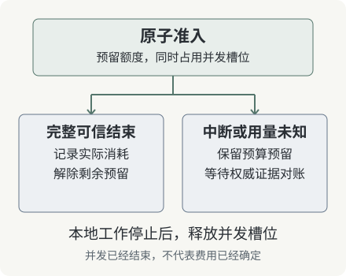

# 第 9 章：用量未知，也是一种需要保存的状态

预算系统最危险的错误之一，是把“没有收到用量”解释成“没有用量”。另一个常见错误是把本地估算写成供应商确认值。前者会提前放出额度，后者会让账单看似精确，却无法对账。

## 9.1 预留与结算各自解决一个问题

预留限制新请求能够承诺多少资源；结算记录已经发生的可信消耗。可以把一个租户的额度写成以下关系：

```text
可用于新请求的额度 = 总额度 - 已结算消耗 - 尚未解除的预留
```

这是一种容量账本模型，不是会计准则或所有供应商的计费模型。退款、阶梯价格、缓存计量、免费额度等需要自己的费用合同，不能偷偷塞入同一个数字。

## 9.2 实验的 credit 合同

实验定义一 credit 等于一字节 UTF-8 文本，计量合同名为 `utf8-bytes-v1`。输入预留取 prompt 编码后的字节数，再加 max_output_units。JSON 与 SSE 封装字节不进入这个教学计量。

例如 prompt 为“你好”，UTF-8 编码后占 6 字节；若输出上限为 20，则预留 26 credits。若最终实际输出为 9 字节，并得到合同正确、字段可信且完整终止的用量，结算可以记录 6 + 9，剩余预留解除。

真实 token 计量与这个例子不同。工具结构、图片、隐藏的服务端处理和缓存等可能影响真实用量。这个 byte 合同的用途是让读者能够独立核算与验证状态转换。

## 9.3 用量事件本身也要验证

网关不能把任意 usage 对象直接写进账本。要检查合同版本、字段类型、非负性、输入量以及已经转发的输出量。出现与合同矛盾的上游信息时，应保留证据并进入待核查，而不是为凑齐一张账单随便取一个值。

usage 到达而 done 没有到达，也未满足本实验的完整结束合同。生产接口可能采用不同终止形式，适配器应按所用协议判断；不能用一个字符串存在性检查代替协议验证。

## 9.4 未知预留不能靠时间自动变成零

中断运行的本地并发可以结束，预算预留却可能继续保留。这会降低可用额度，但准确表达了当前缺少结算证据。后续应由供应商账单、运行查询或授权人工核对完成对账。



为未知状态设置保留期限和告警是必要的，不过“过期”只是需要处理的运维事件，不是证明费用为零的新证据。如果业务选择承担风险提前释放，应该记录这是一项政策决定，并能统计由此产生的超额消耗。

## 9.5 多节点与重启之后

生产账本需要持久化记录、唯一的结算身份和原子状态转换。结算消息可能重复到达，重启后也可能再次处理同一记录，因此“只结算一次”应通过存储约束验证。把输出量放在一个全局变量里，在单进程演示中能工作，却无法支持这些故障窗口。

本地实验没有提供跨进程账本和供应商对账系统。它把未知预留保留下来，方便你看到下一阶段究竟需要增加什么。

**练习。** 一个租户总额 100，已结算 20，正常运行预留 30，未知运行预留 15。还能接受多少额度的新请求？如果把未知预留直接归零，账面可用额会增加多少，增加的依据是什么？
